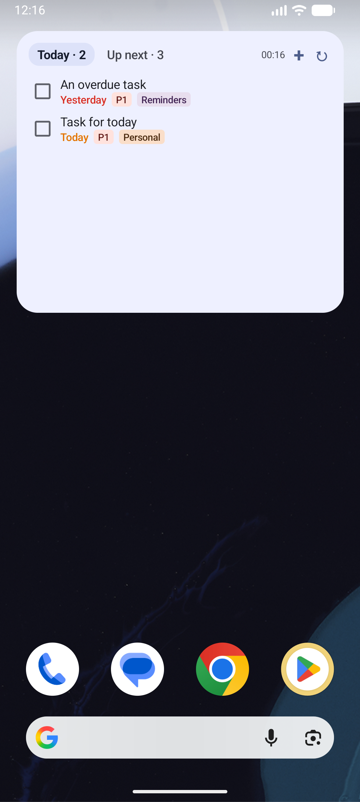
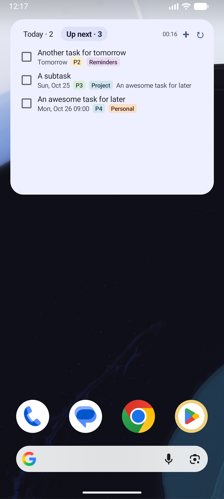
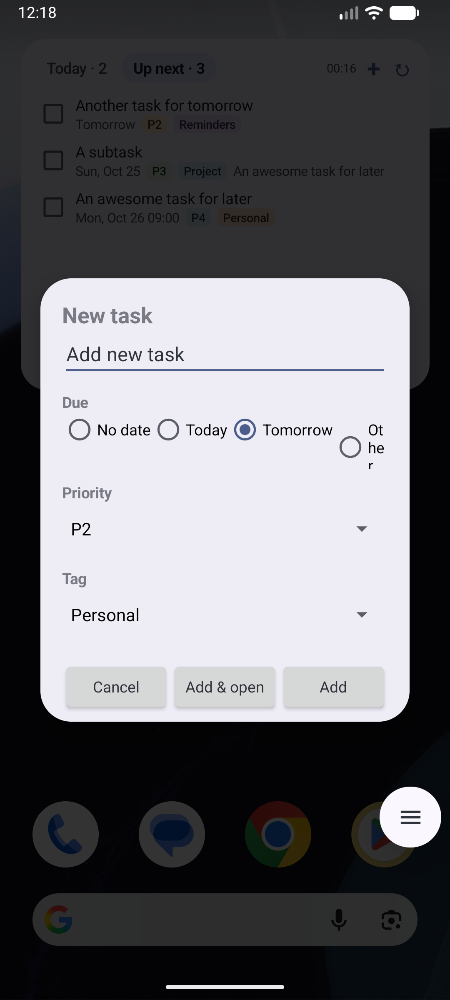
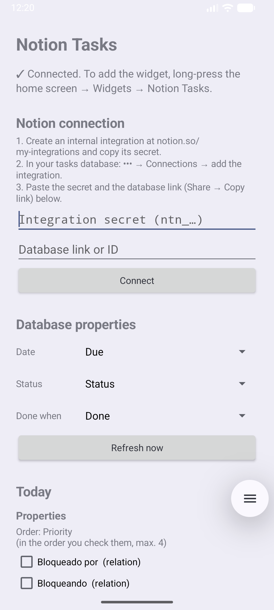
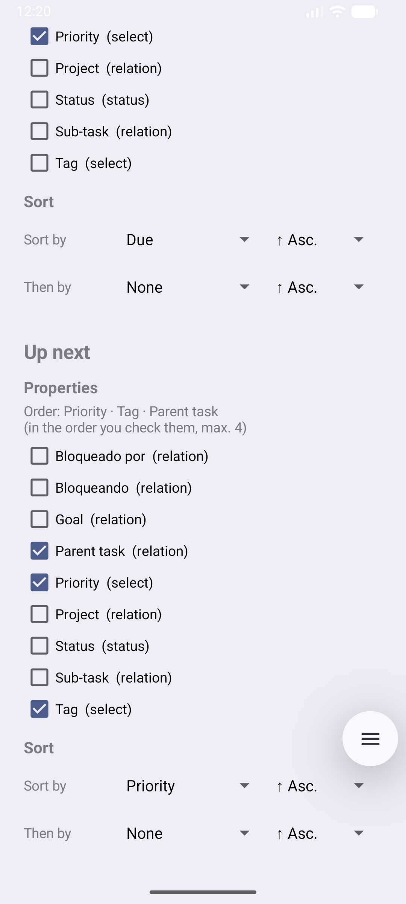

# Notion Tasks — Android widget

Home-screen widget that shows the **pending** tasks from a Notion database and lets you
**check them off**.

- **Two tabs:** **Today** (due today or overdue) and **Up next** (due in the next 7 days).
- Relative dates ("Today", "Tomorrow 10:00", "Wed, Oct 15"): overdue in red, today in orange.
- **Extra properties** next to the date (select, relation, text…). Selects are shown as tags with the
  **same colors as in Notion** (dark mode included); relations show the related page's title
  (e.g. the project).
- The checkbox **completes the task** (status → done).
- Changes show up instantly; if Notion fails, they're reverted and the error is shown.
- **+** button to create a task (title, date and select properties such as tag or priority) without
  opening Notion; "Add & open" opens it in Notion afterwards to fill in the rest.
- Tapping a title opens the page in Notion. ↻ refreshes; it also refreshes on its own every 30 min.
- Everything is set up in the app: no API keys in the source code or the APK.

## Screenshots

<p align="center">
  
  &nbsp;
  
  &nbsp;
  
</p>
<p align="center">
  
  &nbsp;
  
</p>

## 1. Install

**From Android Studio:** open the folder, enable USB debugging on your phone, connect it and press
**Run** (or `./gradlew installDebug`).

**APK:** build it with `./gradlew assembleDebug`, copy `app/build/outputs/apk/debug/app-debug.apk`
to the phone and open it (allow installing apps from that source). Updates install on top and keep
your settings.

## 2. Connect Notion

1. Go to <https://www.notion.so/my-integrations> → **New integration** → type **Internal**.
   Under *Capabilities* keep *Read content*, *Update content* and *Insert content*.
   Copy the **Internal Integration Secret**.
2. Open your tasks database in Notion → `•••` menu → **Connections** → add your integration.
   **Do the same for any related databases** you want to show (e.g. Projects): if the integration
   doesn't have access, Notion returns empty relations without an error.
3. Copy the database link (**Share → Copy link**, or the browser URL).
4. Open the app, paste the secret and the link, and tap **Connect**.
5. Check the **Date**, **Status** and **Done when** pickers. They're filled in automatically
   (for a *Status* property, the first option of its *Complete* group), so usually there's nothing
   to change.
6. Add the widget: long-press the home screen → **Widgets** → **Notion Tasks**.

The database needs a **date** property and a **status** (or **select**) property.

## 3. Per-view settings

For each tab, the app lets you choose (applied instantly):

- **Properties** shown next to the date (max. 4), in the order you check them.
- **Sort:** up to two criteria, ascending or descending (default: by date, oldest first). Selects are
  sorted by the order of their options in Notion, not alphabetically.

## Views

| View | Shows (status ≠ done) |
|---|---|
| **Today** | due today or earlier; a date range counts until its end date |
| **Up next** | due from tomorrow up to 7 days ahead |

The filters live in `viewFilters()` in `data/TaskRepository.kt`, written in the Notion API filter
format. `{today}`, `{today+N}` and `{today-N}` are replaced with the phone's date on every refresh.
The API compares date ranges by their **start**; to filter by the **end** (like "End date" in Notion)
use `date_end` instead of `date` and the app checks it itself (`data/ClientFilter.kt`).

## Structure

```
MainActivity.kt          settings screen: Notion connection + per-view settings (no Compose)
AddTaskActivity.kt       new-task form (the widget's + button)
data/NotionApi.kt        REST calls: data source query, schema, relation titles, PATCH
data/ClientFilter.kt     local evaluation of date_end filters
data/TaskRepository.kt   settings, disk cache, view filters; pushes data to the widgets
data/RefreshWorker.kt    periodic refresh with WorkManager
data/Models.kt           Task, TaskView, WidgetData, NotionConfig, ViewSettings, SortSpec
widget/TasksWidget.kt    Jetpack Glance UI + actions (complete, switch view, refresh)
widget/NotionColors.kt   Notion tag color palette (light/dark)
widget/DateLabel.kt      "Today", "Tomorrow 10:00", "Wed, Oct 15"…
```

## Notes

- Uses API version `2025-09-03`, where databases are queried through *data sources*; the database's
  first data source is used.
- Shows up to 50 tasks per view. Each distinct related page costs one extra request per refresh.
- Sorting by relations isn't possible (API limitation).
- Android doesn't allow automatic refreshes more often than every 15 min; use ↻ for something more immediate.
- The token is stored in the app's private storage on the phone and is excluded from backups.

## License

[MIT](LICENSE)
